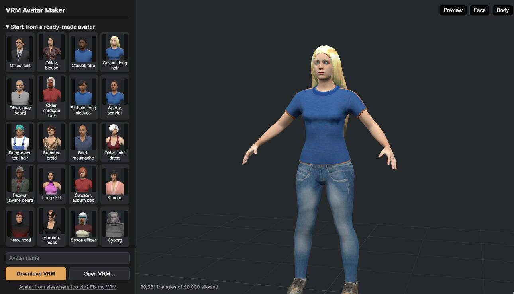
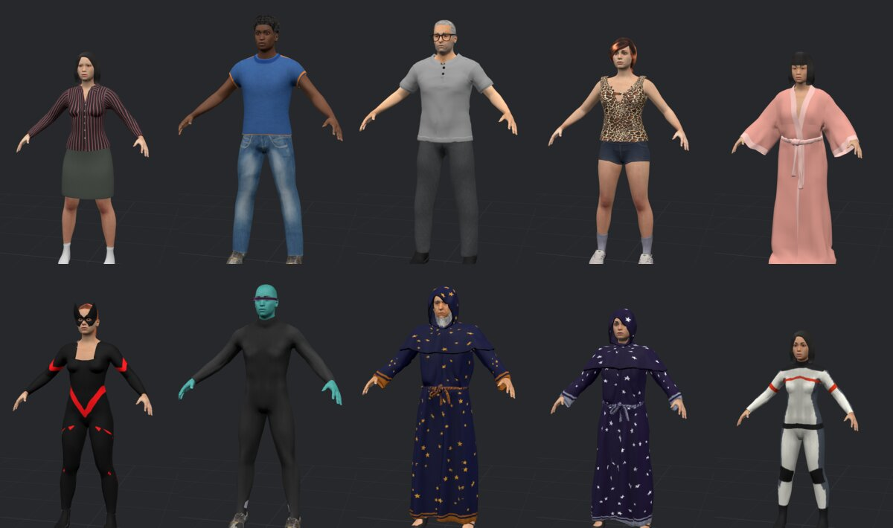

# VRM Avatar Maker

Make a realistic VRM 1.0 avatar in the browser: body, face, skin, eyes, hair, beard, glasses, hats,
clothes and makeup, then download it. Everything an avatar is made of is CC0 (public domain), so the
avatars are yours to use anywhere.

Try it: **https://avatars.somanyrooms.com/**



It was made for meeting avatars in [So Many Rooms](https://somanyrooms.com), so every download fits
a modest budget (at most 40,000 triangles, 16 materials, 2048 px textures, 20 MB) and sits well in a
chair. Any app that reads VRM 1.0 can use them.

## What you get



- **A real person, not anime.** Bodies, skins and clothes come from the MakeHuman community's CC0
  assets, fitted live in the browser as you move the sliders.
- **VRM 1.0 that moves.** Standard humanoid bones, blinking, mouth shapes for talking (aa, ih, ou,
  ee, oh), emotions, eyes that look at a target, and hair that sways (spring bones).
- **Editable again.** The recipe is stored inside the VRM, so opening it in the maker brings back
  every choice.
- **Ready-made avatars** to start from, **Surprise me** for a random person in one of their outfits,
  and a live preview, seated or standing.
- **Plain GLB too.** "Download as GLB" gives the same avatar without the VRM extensions, for Blender,
  game engines and 3D viewers that don't read VRM (bones, skin and face shapes are kept).
- **Share links.** "Copy link" gives a link that opens your avatar in the maker (the choices travel
  after the `#`, so they never reach a server).
- **Fix my VRM** (`/fix/`): shrinks any VRM 0.x or 1.0 that's over the budget (drops unused
  materials, merges look-alikes into an atlas, scales textures, simplifies meshes). It respects the
  VRM's own license: files that forbid changes are refused.
- **Private.** Everything runs in your browser. Nothing is uploaded.

## Run it locally

The site is static: serve `web/` with any web server and open `/editor/`.

```sh
python3 tools/devserver/serve.py      # serves the repo at http://localhost:5288/web/editor/
```

`web/assets/` (body data, clothes, textures, thumbnails) is generated and committed, so this works
without the asset pipeline. three.js, three-vrm and meshoptimizer are vendored in `web/vendor/`;
there is no build step and no outside requests.

## The asset pipeline

To change the catalog of clothes and hair, regenerate `web/assets/` from MakeHuman's assets:

1. Install Blender 5.2 with the **MPFB 2** extension and its CC0 asset packs (system assets, skins,
   hair, eyebrows, eyelashes, clothes packs). Only use items whose own `.mhclo`/`.mhmat` header says
   CC0: some packs labelled CC0 contain items under other licenses.
2. Edit `pipeline/catalog.json` (what's offered, and in which slot).
3. `sh pipeline/make_parts.sh` makes lighter copies of heavy items, the visors, body coverage
   (which body skin a garment hides) and the makeup masks.
4. `python3 pipeline/export_web_assets.py` writes `web/assets/`.
5. `python3 pipeline/make_credits.py` updates `ASSETS.md` and fails if any item's own files don't
   say CC0.

Other tools:

- `pipeline/paint_garments.py`: our own garment designs, painted onto the texture of an existing CC0
  garment by position on the body (catalog items with `"base"`).
- `pipeline/make_plain_shirts.py`: MakeHuman's T-shirts with the MakeHuman logo covered.
- `pipeline/build_avatar.py`: builds one avatar headless in Blender from a recipe (the original
  prototype; the browser editor is the main path now).
- `scripts/validate-gltf.mjs`: runs the Khronos glTF validator on exported files.
- `tools/viewer/`: loads a VRM seated, to check how it sits.

## Layout

```
web/editor/    the maker (editor.js), web/lib/ shared modules (VRM writer, fitting, springs, preview)
web/fix/       Fix my VRM
web/assets/    generated catalog data (committed)
pipeline/      asset factory (Python; some scripts run inside Blender)
assets/        committed pipeline outputs: lighter parts, coverage, painted and plain textures
```

## License

The code is MIT (see `LICENSE`). The avatar assets are CC0; see `ASSETS.md` for every item and its
author. three.js, three-vrm and meshoptimizer keep their own MIT licenses (`web/vendor/*/LICENSE*`).
Avatars you make are yours: the downloaded VRM allows any use, modification and redistribution.
